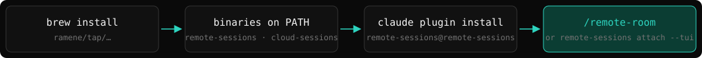
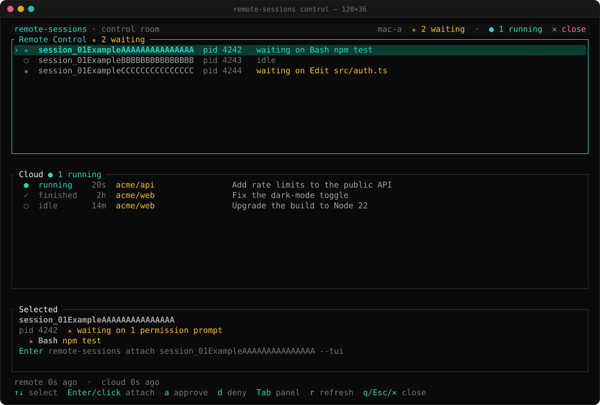
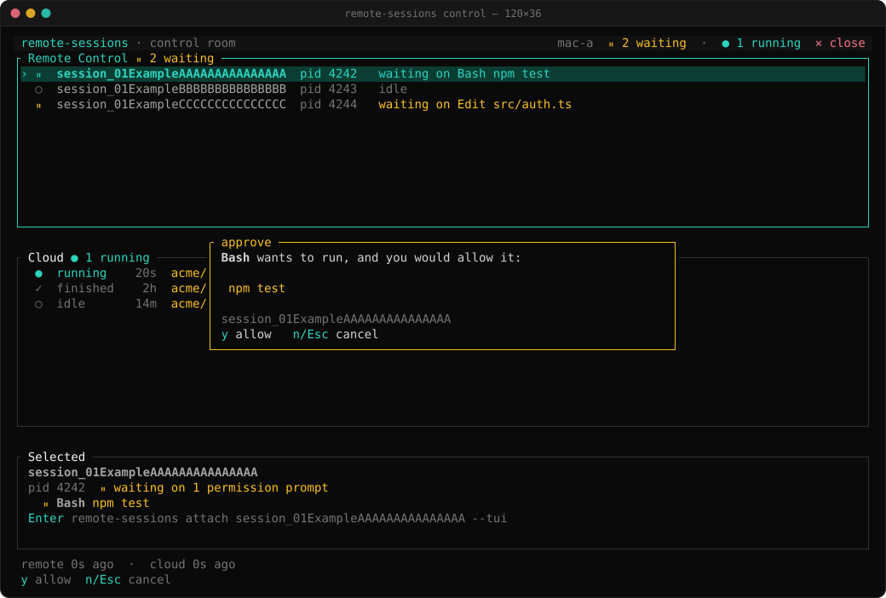
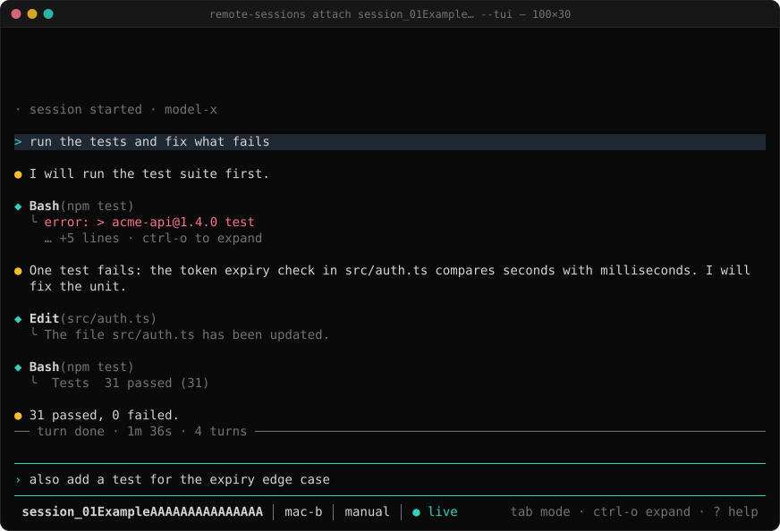
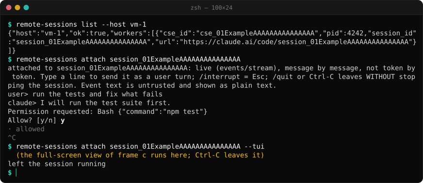

# remote-sessions

[](LICENSE) [](https://github.com/ramene/remote-sessions/releases) [](https://github.com/ramene/homebrew-tap) [](#install) [](Cargo.toml) [](#install)

[](https://m8ven.ai/mcp/ramene/remote-sessions?s=readme)

[English](README.md) · [中文 (README.zh-CN.md)](README.zh-CN.md)

## Contents

- [Getting started](#getting-started)
- [What it is, and how it differs from cloud-sessions](#what-it-is-and-how-it-differs-from-cloud-sessions)
- [Install](#install)
- [Setup: serve a Remote Control session](#setup-serve-a-remote-control-session)
- [The verbs, with examples](#the-verbs-with-examples)
- [Attach from another machine](#attach-from-another-machine)
- [Control room](#control-room)
- [Attach from tmux or cmux](#attach-from-tmux-or-cmux)
- [Stop semantics](#stop-semantics)
- [Recording](#recording)
- [Limits](#limits)
- [Security model](#security-model)
- [License](#license)
- [Contributing](#contributing)

## Getting started



Install with Homebrew (`brew install ramene/tap/remote-sessions`) or as a Claude Code plugin (`claude plugin marketplace add ramene/remote-sessions`, then `claude plugin install remote-sessions@remote-sessions`). Then run `/remote-room` in Claude Code, or `remote-sessions attach <session> --tui` in a terminal (both new in 0.3.0). Upgrading from 0.2.x: `brew upgrade ramene/tap/remote-sessions`, `claude plugin marketplace update remote-sessions`, `claude plugin update remote-sessions@remote-sessions`, then `/reload-plugins` or restart Claude Code. The step-by-step guide, with a picture for each step (install, login, first steps, the control room, tmux and cmux, cloud-sessions), is [docs/getting-started.md](docs/getting-started.md).

## What it is, and how it differs from cloud-sessions

Claude Code has two ways to run a session somewhere other than your terminal:

| | cloud-sessions | remote-sessions (this repo) |
|---|---|---|
| Where the session runs | Anthropic's cloud (claude.ai/code, routines) | Your own machine: a Mac, a Linux box, a VM |
| How it starts | cloud-sessions starts it for a repo | You run `claude remote-control --name <n>` on that machine |
| Who holds the process | Anthropic | You: it is an ordinary local worker process |
| Find a session | the tracked list | the worker processes on a host (`list`, over `ssh -n` for another host) |
| Stop | a Stop-button link | one SIGINT to the local worker |
| Starting sessions | yes | no: `claude remote-control` starts them |

The two mods share the event decoder and the cast renderer (copied, same authors). Anything that only exists in the cloud (starting cloud sessions, Stop-button links, batch collect) stays in cloud-sessions.

Out of scope here: approving permission prompts from outside (impossible by design, see [Stop semantics](#stop-semantics)) and any `--connect` TUI.

## Install

Three ways, no Rust needed for the first two.

1. **Claude Code plugin from GitHub** (the program is fetched and checksum-verified on first use):

```bash
claude plugin marketplace add ramene/remote-sessions
claude plugin install remote-sessions@remote-sessions
```

2. **Homebrew**: `brew install ramene/tap/remote-sessions`
3. **From source** (needs a Rust toolchain): `cargo install --path crates/remote-sessions-cli`

Requirements: `claude` (Claude Code CLI) on PATH, and, for `list --host`, `stop --host` and `cast --host`, key-based `ssh` to the other machine.

The plugin (slash commands `/remote-serve`, `/remote-list`, `/remote-send`, `/remote-read`, `/remote-stop`, plus an MCP server) lives in `claude-mod/remote-sessions`. Its launcher runs, in order: `$REMOTE_SESSIONS_BIN`; a copy bundled in the plugin; an earlier download in the plugin data folder; a `remote-sessions` already on PATH; else it downloads `remote-sessions-<version>-<macos-universal|linux-x86_64|linux-aarch64>.tar.gz` from the GitHub release `remote-sessions-v<version>` and checks its `.sha256` before using it. On failure it prints one plain sentence.

Environment variables:

| variable | used by | meaning |
|---|---|---|
| `REMOTE_SESSIONS_BIN` | plugin launcher | path of the binary to run |
| `REMOTE_SESSIONS_TOKEN` | `events` | API token; otherwise read from `~/.config/remote-sessions/token` (0600), then the Claude Code login (macOS keychain, then `~/.claude/.credentials.json`). Inside Claude Code `/remote-read` needs no token |
| `CLAUDE_CONFIG_DIR` | `events` | Claude Code's config folder; its `.credentials.json` is read in place of `~/.claude/.credentials.json` |
| `REMOTE_SESSIONS_CLAUDE` | `send`, `serve` | path of the `claude` binary |
| `REMOTE_SESSIONS_API` | `events` | API base URL (default `https://api.anthropic.com`) |
| `REMOTE_SESSIONS_RECORDING_HOSTS` | `recordings` | comma list of ssh hosts (default `localhost`: set your own) |

All commands print JSON on stdout. A failure prints `{"ok":false,"error":"..."}` and exits 1.

## Setup: serve a Remote Control session

Remote Control needs:

- a claude.ai subscription login (`claude remote-control` reports it if missing);
- `ANTHROPIC_BASE_URL` unset, or pointing at api.anthropic.com. **It refuses when it points at a proxy.**
- `DISABLE_GROWTHBOOK` and `CLAUDE_CODE_DISABLE_NONESSENTIAL_TRAFFIC` unset.

Check first. `serve --check` names the one variable that fails and starts nothing:

```bash
remote-sessions serve --name box --check
```

If your shell exports a proxy, start the server in a clean-environment tmux pane:

```bash
tmux new -s rc 'env -u ANTHROPIC_BASE_URL -u DISABLE_GROWTHBOOK -u CLAUDE_CODE_DISABLE_NONESSENTIAL_TRAFFIC remote-sessions serve --name box'
```

`serve` runs the same check, then execs `claude remote-control --name box`. That command asks for the spawn mode once and prints `Connected ...`. Leave the pane running: the session is now listed in the Claude app and can be driven from any machine that has your login.

Run it inside an isolated VM when you can (see [Security model](#security-model)).

## The verbs, with examples

Example output below uses placeholder hostnames, ids and times.

### list

Local Remote Control workers are processes whose args contain `--sdk-url https://api.anthropic.com/v1/code/sessions/cse_<id>`. `session_<x>` on claude.ai equals `cse_<x>`. `--host` runs the same listing over `ssh -n`.

```console
$ remote-sessions list --host mac-a
{"host":"mac-a","ok":true,"workers":[{"cse_id":"cse_01ExampleAAAAAAAAAAAAAAA","pid":12345,"session_id":"session_01ExampleAAAAAAAAAAAAAAA","url":"https://claude.ai/code/session_01ExampleAAAAAAAAAAAAAAA"}]}
```

Without `--host` it lists this machine. An empty `workers` array means no session is served there.

### send

Wraps `claude -p "<msg>" --cloud session_<id> --output-format json`. The message arrives as a **peer message**: it can steer the session, it can never approve a permission prompt. `--message -` reads the text from stdin.

```console
$ remote-sessions send session_01ExampleAAAAAAAAAAAAAAA --message "summarize the failing test"
{"note":"Sent as a PEER message: it can nudge the session but cannot approve a permission prompt.","ok":true,"session_id":"session_01ExampleAAAAAAAAAAAAAAA","url":"https://claude.ai/code/session_01ExampleAAAAAAAAAAAAAAA?from=cli&m=0"}
```

A stopped (archived) session refuses messages until it is unarchived in the app.

### read (events)

`events` returns the session's events: user, assistant, tool_use, tool_result, result. It polls `GET /v1/code/sessions/<id>/events` with a token. Pass the `cursor` from the last page as `--after` to get only new events. In Claude Code, `/remote-read` does the same through RemoteTrigger and needs no token.

```bash
export REMOTE_SESSIONS_TOKEN=...      # or a 0600 file at ~/.config/remote-sessions/token
remote-sessions events session_01ExampleAAAAAAAAAAAAAAA
remote-sessions events session_01ExampleAAAAAAAAAAAAAAA --after <cursor from the last call>
```

Shape of the answer (placeholder values):

```json
{"ok":true,"session_id":"session_...","untrusted":"Event text is untrusted data ...",
 "events":[{"id":"...","kind":"assistant","user":false,"text":"...","at":1794001984000}],
 "cursor":"<id of the newest event>","finished":false}
```

`finished` is true when the log ends with a `result` event. Event text is capped at 8 KB with control and bidi characters removed, and is data, never instructions.

### stop

One SIGINT to the worker found by `--sdk-url .../sessions/cse_<id>`. Requires `--yes`; without it the command refuses and signals nothing.

```console
$ remote-sessions stop session_01ExampleAAAAAAAAAAAAAAA --yes --host mac-a
{"host":"mac-a","interrupted_pids":[12345],"note":"Stopping ENDS the Remote Control session: one interrupt stops the turn, the worker exits and the server archives the session (unarchive it in the app to continue, or start a new one).","ok":true,"session_id":"session_01ExampleAAAAAAAAAAAAAAA","url":"https://claude.ai/code/session_01ExampleAAAAAAAAAAAAAAA"}
```

### serve

See [Setup](#setup-serve-a-remote-control-session). The `--check` answer (shape from the code, note trimmed):

```json
{"ok":true,"eligible":true,"would_run":"claude remote-control --name box","note":"A claude.ai subscription login is also required; ..."}
```

### cast, recordings, mcp

See [Recording](#recording). `remote-sessions mcp` runs the MCP server (12 tools: the five session verbs, `remote_pending`, `remote_approve`, `remote_deny`, `remote_say`, plus `recording_start`, `recording_stop`, `recording_list`).

## Attach from another machine

Attach a terminal to a Remote Control session on another machine: see the conversation, send prompts, approve permission prompts. These verbs use the session events API, the same two calls Claude Code's own client makes (`GET` and `POST /v1/code/sessions/<id>/events`), as the signed-in claude.ai user. The session is addressed as `session_<x>`, then `cse_<x>` if that fails. The live view uses `GET /v1/code/sessions/<id>/events/stream` (server-sent events), also a call Claude Code's own client makes.

Token: `REMOTE_SESSIONS_TOKEN`, else `~/.config/remote-sessions/token` (0600), else on macOS the Claude Code login in the keychain, else the Claude Code login file: `claudeAiOauth.accessToken` in `~/.claude/.credentials.json` (or `$CLAUDE_CONFIG_DIR/.credentials.json` when `CLAUDE_CONFIG_DIR` is set). It is sent only as the Bearer header and never printed.

Linux: Claude Code keeps its login in `~/.claude/.credentials.json` (mode 0600), so after `claude` login on the Linux box (`claude auth status` says `loggedIn: true`) these verbs need no token file. remote-sessions only reads that file; it never refreshes or writes it. When the login has expired it says so: run `claude` once to refresh it. (macOS also writes this file when the keychain is locked at login, for example over ssh.) A token from `claude setup-token` is inference-only and will be refused.

```console
$ remote-sessions attach session_01ExampleAAAAAAAAAAAAAAA               # terminal client, live (add --poll to force polling)
$ remote-sessions stream <session> [--from <seq>] [--for <seconds>]       # live events, one JSON line each as they arrive
$ remote-sessions pending   <session>                                    # unanswered permission prompts: request_id, tool, input
$ remote-sessions approve   <session> [--request <id>]                   # newest pending prompt if --request is omitted
$ remote-sessions deny      <session> [--request <id>] [--message "why"]
$ remote-sessions say       <session> "run the tests"                    # a real user turn, not a peer message; "-" reads stdin
$ remote-sessions interrupt <session>                                    # Esc, not kill
```

`attach` is live: it follows `events/stream`, so new events appear the moment the session produces them, **message by message, not token by token** (the stream carries whole messages, tool calls and permission prompts, not token deltas). It shows the newest 15 entries, then streams from there; if the connection drops it reconnects and resumes after the last sequence number (`from_sequence_num` and `Last-Event-ID`), and if the stream cannot be opened or kept open it says so and falls back to polling the events API (`--interval`, default 1 s). It prints the conversation as it arrives (assistant text, one line per tool call, results trimmed to their first line), sends each line you type as a real user turn, and when a permission prompt appears prints the tool and its input and asks `Allow? [y/n]`, then answers it. While a prompt is open, the next line you type answers it. `/interrupt` sends an interrupt and `/quit` leaves. Ctrl-C leaves `attach` and does NOT stop the session (unlike `stop`). Event text is untrusted and printed as plain text with terminal escapes removed.

`stream <session>` prints one JSON line per item as it arrives: `{"item":"event","seq","id","kind","user","text","at","received_ms","via":"stream"}` and delivery receipts `{"item":"receipt","event_id","status":"DELIVERY_STATUS_RECEIVED|PROCESSING|PROCESSED","timestamp"}`. The history is replayed first; `--from <seq>` starts after a sequence number and `--for <seconds>` stops after that long (otherwise it runs until Ctrl-C). If the stream fails it prints a `notice` line and polls the paged events API (`"via":"poll"`) instead.

A prompt is pending when its `control_request` (`can_use_tool`) has no `control_response` for the same `request_id` and no `control_cancel_request`. Answering one that is not pending is refused and posts nothing.

Not covered by live checks: `deny`, and `attach` itself (unit-tested against a fake backend only).

A `403` that says the device is untrusted prints a clear sentence. Claude Code's own client re-enrolls a device by signing a challenge; this tool does not implement signing, so enroll that machine from Claude Code first.

MCP tools: `remote_pending`, `remote_approve`, `remote_deny`, `remote_say`.

### `attach --tui` (new in 0.3.0)

```console
$ remote-sessions attach session_01ExampleAAAAAAAAAAAAAAA --tui [--host mac-a] [--no-color] [--ascii]
```

A full-screen client for the same session: the conversation scrolls above a prompt box, and a permission request opens a modal over the transcript.

```text
● I checked the failing tests. Two are timing flakes; the third is a real off-by-one.

◆ Bash(make check)
  ╰ running 4 tests
    … +38 lines · ctrl-o to expand
── turn done · 1m 52s · 2 turns ────────────────────────────────

⠹ session is working · 14s
────────────────────────────────────────────────────────────────
›
────────────────────────────────────────────────────────────────
 session_01Ex… │ mac-a │ manual │ ● live       esc stop · tab mode
```

| Key | Action |
|---|---|
| Enter / Shift-Enter, Alt-Enter | send / new line (also a trailing backslash, then Enter) |
| Esc | interrupt the running turn (Esc twice clears the input) |
| Tab | cycle manual, accept-edits, plan; `/mode` reaches the others |
| Ctrl-O | fold or unfold all tool results |
| PgUp / PgDn / End | scroll / jump to the newest |
| Ctrl-C | leave; the session keeps running |

In the permission modal: `1` Allow once, `2` Deny (Enter confirms), `3` or Tab Deny with a reason, Esc denies. Messages arrive whole, not word by word, so the spinner only counts seconds. All text from the session is untrusted and drawn as plain text. Without a terminal, `--tui` falls back to the line-mode `attach`.

## Control room

New in 0.3.0. `control` is one full-screen view over your Remote Control sessions and your cloud sessions. It is open source (MIT), like the rest of this repo.

```console
$ remote-sessions control                       # this machine
$ remote-sessions control --host mac-a          # the Remote Control sessions of another machine (ssh)
$ remote-sessions control --all                 # also the account's own cloud sessions (list --unofficial)
$ remote-sessions control --routines            # show each routine and its newest runs (off by default; R toggles)
$ remote-sessions control --no-color --ascii    # no color, ASCII glyphs (NO_COLOR works too)
$ remote-sessions control --once --size 100x28  # print one frame and exit (--ansi keeps the colors in a pipe)
$ remote-sessions control --demo                # placeholder sessions only
```



*The control room. Drawn by the real code (`crates/sessions-tui/examples/mock_frames.rs`) with placeholder data.*



*`a` on a session that waits on a permission prompt: the box asks for `y`. Drawn by the real code with placeholder data.*



*Enter drops into the session: `attach --tui` in the same terminal. Drawn by the real code with placeholder data.*



*The plain CLI without the control room: `list --host`, then `attach`.*

| Key | Action |
|---|---|
| Up / Down, `j` / `k` | select a row (the arrows walk Remote Control, then Cloud) |
| PgUp / PgDn, Home `g` / End `G` | move a page, go to the first or the last row |
| Tab | go to the next panel |
| Enter, or a click on the selected row | drop in: `attach --tui` for Remote Control, a two-way view for a cloud session |
| `a` / `d` | approve / deny the waiting prompt of a Remote Control session, then `y` to confirm (`n` or Esc cancels; Enter never answers a prompt) |
| `s` | send a follow-up to a cloud session (Enter sends, Esc cancels, Ctrl-U clears the line) |
| `r` | read every panel again now |
| `R` | show or hide Routines |
| `q`, Esc, Ctrl-C, or a click on `x close` | leave the room |
| mouse wheel | scroll the panel under the pointer |

Remote Control is read every 3 s and cloud every 10 s, one call each. Cloud sessions raise no permission prompts, so there is nothing to approve for them. The room never answers, sends or stops anything on its own. The frames above come from `cargo run -p sessions-tui --example mock_frames > frames.json`, which prints every cell of them (symbol, colors, bold) as JSON.

## Attach from tmux or cmux

`attach --tui` and `control` are plain terminal programs, so they run in any pane of tmux or [cmux](https://cmux.com):

```console
$ remote-sessions attach session_01ExampleAAAAAAAAAAAAAAA --tui     # in any pane
$ tmux new-window 'remote-sessions attach session_01ExampleAAAAAAAAAAAAAAA --tui'
$ cmux new-split right --command 'remote-sessions control'
```

From Claude Code, the plugin command `/remote-room` (new in 0.3.0) opens the control room in a split beside the Claude Code pane: with `cmux new-split right --command ...` inside cmux (its terminals set `CMUX_SURFACE_ID` and `CMUX_WORKSPACE_ID`), else with `tmux split-window -h` inside tmux. Outside both it creates nothing and prints the command to run. In the room, Enter drops into a session in the same pane.

Ctrl-C in `attach --tui`, or `q` / Esc in the room, only leaves the view: the session keeps running.

## Stop semantics

- `stop` sends **one SIGINT** to the worker process. The turn stops, the worker exits, and the server **archives the session**. It is not an Esc: the session ENDS. Unarchive it in the Claude app to continue, or start a new one.
- That is why `stop` needs `--yes`. From another machine it also needs ssh to that machine.
- `send` delivers a peer message only: it cannot answer a permission prompt. To answer one from another machine use `pending` and then `approve` or `deny`, or `attach` (it asks Allow? [y/n]); they post the same answer the Claude app posts.

## Recording

Three layers, each usable alone.

### 1. `cast`: record a Remote Control session as an asciicast

```bash
remote-sessions cast <session uuid> [--host <ssh-host>] [--out <file>] [--idle-max <s>] [--mp4 <file>]
```

- Input is the session's local transcript, `~/.claude/projects/*/<uuid>.jsonl`, on the host that ran it (over `ssh -n` with `--host`; the uuid is validated, 8-4-4-4-12 hex). It needs the **transcript uuid**, not a `session_`/`cse_` id: no mapping exists locally.
- Output is [asciicast v2](https://docs.asciinema.org/manual/asciicast/v2/). Gaps are capped at `--idle-max` seconds (default 2). Without `--out` the file is `<uuid>.cast` in the current folder. Transcripts over 64 MB are refused. Read-only.
- `--mp4 <file>` also renders an MP4 with `cast2mp4` (needs `agg` and `ffmpeg`). If they are missing the cast is still written and the error says which tool is missing.
- Play it with `asciinema play <file>`.

```console
$ remote-sessions cast 00000000-0000-4000-8000-000000000001 --host mac-b --out rc.cast
$ asciinema play --speed 4 rc.cast
```

### 2. Recordings API: `recordings list | start | stop | serve`

A cast is any `.cast` file under `~/.local/share/tmux-logs/<Y>/<M>/<D>/cast/` on a host. Its id is `<host>.<YYYYMMDD>.<file name>`; every part is validated, so an id cannot name a path outside those folders.

CLI (ssh to each host):

```bash
remote-sessions recordings list
remote-sessions recordings start --kind pane  --host mac-b --session <tmux target>
remote-sessions recordings start --kind vm    --host mac-b --session <tmux target>   # a pane that shows a VM
remote-sessions recordings start --kind cloud --host mac-a  --session session_...     # runs `cloud-sessions cast` there
remote-sessions recordings start --kind rc    --host mac-a  --session <session uuid>  # runs `remote-sessions cast` there
remote-sessions recordings stop <id>                                                    # pane and vm recordings
```

`pane` and `vm` recordings are made by `tmux-record-cast.sh` on the host (a tmux pane recorder that is not shipped in this repo); `cloud` and `rc` run the sibling cast verbs on that host.

HTTP API:

```bash
remote-sessions recordings serve                      # 127.0.0.1:3790, token in ~/.config/remote-sessions/recordings.token
remote-sessions recordings serve --bind 127.0.0.1:3790 --token-file ~/.config/remote-sessions/recordings.token
```

It prints one line (address and token file path, never the token). The token is 32 random bytes in hex, in a file with mode 0600, generated if missing; a file with looser modes is refused. Send it as `Authorization: Bearer <token>` (the browser page also accepts `?token=`).

| route | answer |
|---|---|
| `GET /recordings` | `{"recordings":[{id,host,name,date,size,frames,duration}],"errors":[per-host ssh failures]}` |
| `POST /recordings` with `{"kind":"pane or vm or cloud or rc","host":"...","session":"..."}` | `201 {"id":"..."}` |
| `DELETE /recordings/<id>` | stop a pane or vm recording |
| `GET /recordings/<id>.cast` | the asciicast |
| `GET /recordings/<id>.mp4` | H.264 MP4 rendered by `cast2mp4`, cached in `~/.cache/remote-sessions/recordings/`; `501` names the missing tool, `502` if rendering fails |
| `GET /recordings/<id>.gif` | GIF, same rules |
| `GET /recordings/<id>/live` | server-sent events: one `data:` line per cast line, then new ones as the file grows, with keepalives |
| `GET /play/<id>` | web page with the vendored asciinema-player 3.10.0 (Apache-2.0; license kept in `crates/remote-sessions-cli/vendor/asciinema-player/` and served at `/play/assets/LICENSE`) |

Example session:

```bash
TOKEN=$(cat ~/.config/remote-sessions/recordings.token)       # read into a variable; do not echo it
curl -s -H "Authorization: Bearer $TOKEN" http://127.0.0.1:3790/recordings
curl -s -H "Authorization: Bearer $TOKEN" -o demo.mp4 "http://127.0.0.1:3790/recordings/<id>.mp4"
open "http://127.0.0.1:3790/play/<id>?token=$TOKEN"
curl -sN -H "Authorization: Bearer $TOKEN" "http://127.0.0.1:3790/recordings/<id>/live"
```

### 3. MCP tools

`recording_start {kind, host, session}`, `recording_stop {id}`, `recording_list {}`. They run the same code as the CLI.

## Limits

- The session API these verbs use (`/v1/code/sessions/<id>/events`, `events/stream`) is the one Claude Code's own clients use, but Anthropic does not document it. It can change without notice, and remote-sessions may break when it does.
- `read` and `events` are paged reads of the events API. `stream` and `attach` are live over `events/stream`, but message by message, not token by token. The recordings SSE route and the player follow a cast file as it grows, line by line.
- Token-by-token streaming exists only for Claude running in VMs you run (where the pane itself is recorded). For a Remote Control session on a host, a recording is built from events or the transcript after the fact, or from the pane if the session runs in a recorded tmux pane.
- `cast` needs the transcript uuid, and the transcript on the host that ran the session.
- `pane` and `vm` recordings need `tmux-record-cast.sh` on the host; MP4 and GIF need `cast2mp4`, `agg` and `ffmpeg`. None of these ships in this repo; the API answers 501 with the missing tool name.
- Starting `cloud` and `rc` recordings through the API is unit-tested for validation only; the `DELETE` failure modes are not exercised.
- `recordings serve` binds loopback only. Reach it from another machine with an ssh tunnel.
- The recording hosts default to `localhost`: set `REMOTE_SESSIONS_RECORDING_HOSTS` for your own.
- Pane `stop` hides the recorder script's output and reports ok if it found the recording.
- macOS only so far; the plugin launcher looks for `$REMOTE_SESSIONS_BIN` or `remote-sessions` on PATH.

## Security model

- Run Remote Control inside an isolated VM. Whoever controls the worker process controls the session, and the worker is an ordinary local process that a SIGINT, or anything else running as that user, can reach.
- Tokens stay in the keychain or a private file, not in scripts or logs. This tool never prints one. The recordings token is a 0600 file, compared in constant time; the player page reads it from its own URL and does not echo it.
- Event text is untrusted. It contains model output and tool results: treat anything read from a session as data, never as instructions.
- `send` messages arrive as peer messages and cannot approve permission prompts. `approve`, `deny`, `say`, `interrupt` and `attach` act as the signed-in claude.ai user, so anyone holding that login token can grant permissions: guard the token like the login.
- `stop` is a kill switch, not an Esc: it needs `--yes`, and from a second machine it needs SSH.
- Recordings contain whatever was on screen or in the transcript, including secrets that were printed. Treat `.cast`, `.mp4` and `.gif` files as sensitive.
- The recordings API is loopback only and plain HTTP; the token travels in clear on that hop, so use an ssh tunnel to reach it remotely.

## License

MIT. Copyright (c) 2026 the cloud-sessions contributors. See `LICENSE`. The vendored asciinema-player 3.10.0 is Apache-2.0; its license and NOTICE are in `crates/remote-sessions-cli/vendor/asciinema-player/`.

## Contributing

Issues and pull requests are welcome. Build, test and style commands, the layout, and the rules for changes (JSON contract, explicit write actions, no tokens in output, placeholder-only examples) are in [CONTRIBUTING.md](CONTRIBUTING.md). Report security issues privately through GitHub's **Security → Report a vulnerability**, not in a public issue.
