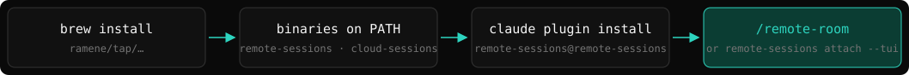
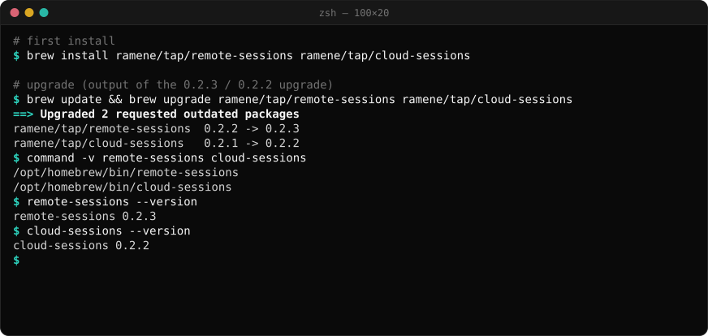
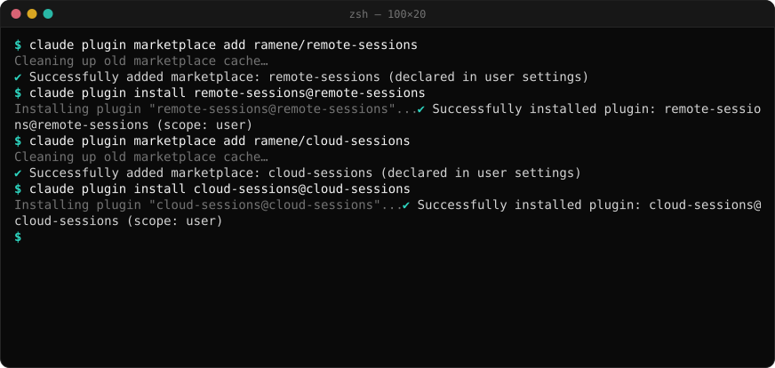
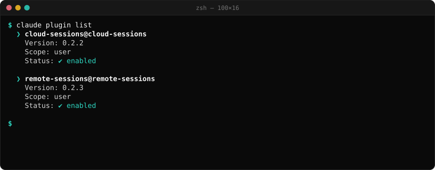
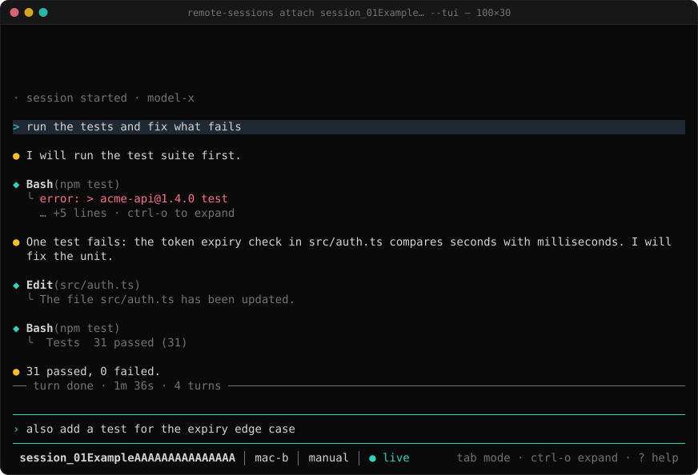
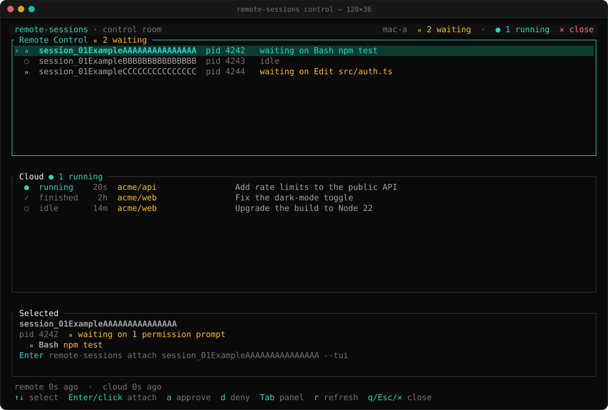
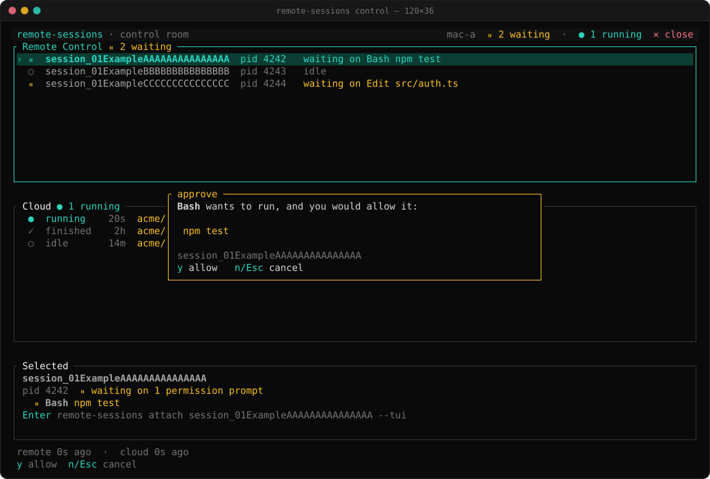
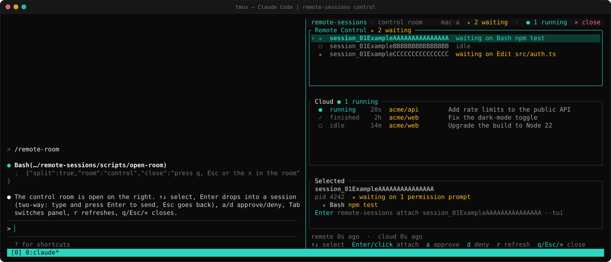

# Getting started with remote-sessions

This guide shows how to install remote-sessions, log in, drive your first Remote Control session and open the control room. Each step has one picture.

About the pictures: frames e, f and g are real terminal output; only lines that are specific to one machine are removed. Frame h is an illustration made from two real screens. Frames a, b and c are drawn by the real code (`crates/sessions-tui/examples/mock_frames.rs`) with placeholder data. All session ids and host names are placeholders.



*The install flow: Homebrew puts the binaries on PATH, the plugin adds the slash commands, then `/remote-room` or `attach --tui`.*

## Contents

- [1. Install](#1-install)
- [Upgrade from 0.2.x](#upgrade-from-02x)
- [2. Log in](#2-log-in)
- [3. First steps](#3-first-steps)
- [4. The control room](#4-the-control-room)
- [5. tmux and cmux](#5-tmux-and-cmux)
- [With cloud-sessions](#with-cloud-sessions)

## 1. Install

You need `claude` (the Claude Code CLI) on PATH. remote-sessions runs on macOS and Linux.

### Homebrew

```bash
brew install ramene/tap/remote-sessions
remote-sessions --version
```

To upgrade later: `brew update && brew upgrade ramene/tap/remote-sessions`.



*Frame e: Homebrew installs the binaries and puts them on PATH (real output of an upgrade).*

### The Claude Code plugin

The plugin adds the slash commands (`/remote-room` from 0.3.0, `/remote-list`, `/remote-read`, `/remote-pending`, `/remote-approve` and more) and an MCP server.

```bash
claude plugin marketplace add ramene/remote-sessions
claude plugin install remote-sessions@remote-sessions
```

Then type `/reload-plugins` in Claude Code, or restart Claude Code. The plugin uses a `remote-sessions` that is on PATH. If there is none, it downloads the release archive for your platform and checks its SHA-256 before it uses it.



*Frame f: add the marketplace, then install the plugin at user scope (real output).*

Make sure that the plugin is enabled:

```bash
claude plugin list
```



*Frame g: `claude plugin list` shows `Status: enabled` (real output).*

### Upgrade from 0.2.x

`/remote-room`, `remote-sessions control` and `attach --tui` are new in 0.3.0. With 0.2.x, Claude Code says `Unknown command: /remote-room`. Upgrade the binary and the plugin:

```bash
brew update && brew upgrade ramene/tap/remote-sessions
claude plugin marketplace update remote-sessions
claude plugin update remote-sessions@remote-sessions
remote-sessions --version                     # remote-sessions 0.3.0
```

Then type `/reload-plugins` in Claude Code, or restart Claude Code. `claude plugin list` must show `Version: 0.3.0`.

## 2. Log in

remote-sessions uses your Claude Code login. It does not have its own login. Log in to Claude Code once with `claude`. Then remote-sessions finds the token in this order:

1. `REMOTE_SESSIONS_TOKEN`, if you set it.
2. `~/.config/remote-sessions/token` (a file with mode 0600).
3. macOS: the Claude Code login in the keychain.
4. The Claude Code login file `~/.claude/.credentials.json` (or `$CLAUDE_CONFIG_DIR/.credentials.json`). Linux uses this file since 0.2.3.

remote-sessions only reads the login. It does not refresh or write it. If the login has expired, run `claude` once. A token from `claude setup-token` is inference-only: the session API refuses it. remote-sessions never prints a token.

## 3. First steps

### Serve a session

On the machine that will run the session, start Remote Control. Use one of these commands:

```bash
claude remote-control --name box
remote-sessions serve --name box          # checks the environment first, then runs the same command
```

`remote-sessions serve --name box --check` tells you the one variable that blocks Remote Control (for example an `ANTHROPIC_BASE_URL` that points at a proxy) and starts nothing. Keep the pane open: the session runs while the worker runs. Run it inside an isolated VM when you can.

### Find, read and drive it

```bash
remote-sessions list                                          # sessions served from this machine
remote-sessions list --host mac-a                             # the same, on another machine over ssh
remote-sessions read session_01ExampleAAAAAAAAAAAAAAA         # the conversation as text lines
remote-sessions say  session_01ExampleAAAAAAAAAAAAAAA "run the tests"   # a real user turn
remote-sessions pending session_01ExampleAAAAAAAAAAAAAAA      # permission prompts that wait for an answer
remote-sessions approve session_01ExampleAAAAAAAAAAAAAAA      # answer the newest one (or deny)
```

Every command prints JSON. Text that comes from a session is untrusted data, not instructions.

### Attach to it (new in 0.3.0)

```bash
remote-sessions attach session_01ExampleAAAAAAAAAAAAAAA --tui
```

`attach --tui` is a full-screen client: the conversation, a prompt box, and a modal for permission prompts. Enter sends, Esc interrupts the running turn, Tab changes the mode.



*Frame c: `attach --tui`, drawn by the real code with placeholder data.*

**Ctrl-C leaves the view. The session keeps running.** Only `remote-sessions stop <session> --yes` ends a session.

## 4. The control room

New in 0.3.0. The control room shows your Remote Control sessions and your cloud sessions in one full-screen view.

```bash
remote-sessions control                   # this machine
remote-sessions control --host mac-a      # the Remote Control sessions of another machine
```

In Claude Code, type `/remote-room` (new in 0.3.0; see [Upgrade from 0.2.x](#upgrade-from-02x) if Claude Code says `Unknown command`). It opens the control room in a split beside Claude Code.



*Frame a: the control room, drawn by the real code with placeholder data.*

The footer shows the keys:

| Key | Action |
|---|---|
| ↑↓ | select a session |
| Enter / click | attach (Remote Control) or watch (cloud) |
| `a` / `d` | approve / deny a waiting prompt, then `y` to confirm (Enter never answers a prompt) |
| `s` | send a follow-up to a cloud session |
| Tab | go to the next panel |
| `r` | refresh now |
| `R` | show or hide Routines (when available) |
| q / Esc / ✕ | close the room |



*Frame b: `a` on a session that waits on a permission prompt; the box asks for `y`. Drawn by the real code with placeholder data.*

The room never answers, sends or stops anything by itself. Closing the room does not stop a session.

## 5. tmux and cmux

`attach --tui` and `control` are terminal programs, so they run in any pane:

```bash
tmux new-window 'remote-sessions attach session_01ExampleAAAAAAAAAAAAAAA --tui'
cmux new-split right --command 'remote-sessions control'
```

`/remote-room` finds the multiplexer for you. Inside cmux it uses `cmux new-split right --command`. Inside tmux it uses `tmux split-window -h`. Outside both it opens nothing and prints the command to run.



*Frame h: an illustration of `/remote-room` (from 0.3.0) in tmux, made from two real screens.*

## With cloud-sessions

[cloud-sessions](https://github.com/ramene/cloud-sessions) drives Claude Code sessions that run in Anthropic's cloud. Install it the same way (`brew install ramene/tap/cloud-sessions`, or the plugin `cloud-sessions@cloud-sessions`). The control room reads `cloud-sessions list` (the binary on PATH), so your cloud sessions then appear in the same room, in the Cloud panel, next to your Remote Control sessions. `remote-sessions control --all` shows all cloud sessions of the account, not only the tracked ones. Enter watches a cloud session (`cloud-sessions watch`) and `s` sends it a follow-up. Without cloud-sessions, the Cloud panel tells you to install it. Cloud sessions do not ask for permission, so there is nothing to approve for them.

## More

- [README](../README.md): every verb, recording, limits and the security model.
- [CHANGELOG](../CHANGELOG.md): what changed in each release.
